# [FlutterKaigi 2026 直前・ワークショップ](https://flutterkaigi.connpass.com/event/405510/)

# AI を使った Flutter 開発の再構築ワークショップ

このワークショップでは、Flutter チームが提唱する AI 支援による開発の中心となる **[Flutter Agent Plugins](https://github.com/flutter/agent-plugins)** の掘り下げを行います。

はじめに現在のフロンティアモデルが、どこまで Flutter アプリを作れるようになっているのか、  
どれぐらいエラーコードを修正できるようになっているのかの体験を通じて、

Flutter Agent Plugin が提供する Agent Skills だけでなく裏方の Flutter|Dart MCP サーバや Dart LSP サーバの存在についても知っていただき、

AI を活用するアイディアや、最近の Flutter 公式の AI関連のトピックにも触れさせていただきます。

このワークショップが、AI を使った Flutter 開発の再構築 のお役に立てれば幸いです。

---

- ワークショップでは、Google アカウントを使った Gemini 無料枠を利用します。  
  ワークショップに関心を持った方々に幅広く参加していただけるよう、Google アカウントの Gemini 無料枠を利用します。  
  参加者ご自身の Google アカウントを使いますが、AI利用のためだけの新規アカウント作成やクレジットカード登録は不要です。

  - Google アカウントの [Gemini 無料枠には、利用可能モデルや使用量制限がある](https://support.google.com/gemini/answer/17004136?hl=ja&sjid=9846380269382269129-NC)ことに注意してください。  
    ①無料枠で使えるモデルは、Gemini Flash-Lite のみです。  
    ②無料枠の使用量上限のリセットは週単位です。（**上限になれば翌週まで使えません**）  
    ③無料枠のコンテキストサイズは、1M(100万)トークンです。（推論力に制限があります）  
    ④プロンプトの複雑度や会話の長さにより使用量の消費が増大します。  

  - Antigravity 無料枠と Gemini web Apps 無料枠は分かれています。  
    このため Antigravity 無料枠の上限になっても、Gemini Web Apps は利用できます。  
    **無料枠の方は、ワークショプ前の数日間の Anitigravity 利用を控えていただくよう願います。**

_本ドキュメントは、Geminiを使って調査｜生成されたドキュメントをベースに作成しました。_

---
---

## はじめに

このワークショップは、Antigravityで **[Flutter Agent Plugins](https://github.com/flutter/agent-plugins)** の掘り下げを体験してもらうため、

[ワークショップ 環境設定ガイド](https://github.com/FlutterKaigi/conference-workshop-2026/blob/main/docs/workshop_guilde_2026.md)を参照して、
Flutter 開発環境と Antigravity CLI および Ollama と Crush をインストールされていると思います。

以下のコマンドで、これから行うワークショップのリポジトリをクローンしてください。

`git clone git@github.com:FlutterKaigi/conference-workshop-2026.git`  
または `git clone https://github.com/FlutterKaigi/conference-workshop-2026.git`  


- FlutterKaigi 2026 ワークショップの GitHubリポジトリ  
  https://github.com/FlutterKaigi/conference-workshop-2026

<br/>

### Antigravity ワークスペースの作成

ワークショップのリポジトリをクローンされた方は、
`1_create_game/breakout` ディレクトリをターミナルで開けば、ワークショップ用の Antigravity ワークスペースとして利用できます。

もしも手動で任意の場所にワークスペースを作りたい場合は、ターミナルで以下のコマンドを実行してください。

```bash
# 任意の場所に handson_agy ディレクトリを作成。
makdir handson_agy
cd handson_agy

# 空の AGENTS.md ファイルと .agents/ ディレクトリを作成する。
touch AGENTS.md 
mkdir .agents/
```

_Antigravity ワークスペースは、空ディレクトリであっても構いません。_

<br/>

---
---

### Antigravity を使い始める。

#### Antigravity へのサインインと利用規約への同意＋ワークスペース信任の確認

- step.1  
  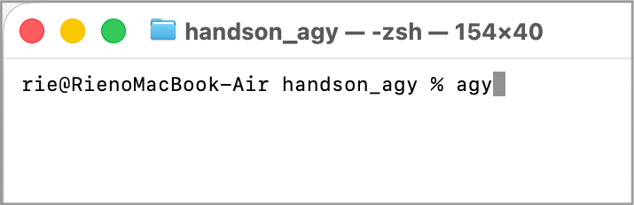  
  ターミナルを開き、ワークスペースディレクトリに移動してから、`agy` コマンドを実行して Antigravity CLI を起動します。

<br/>

- step.2  
  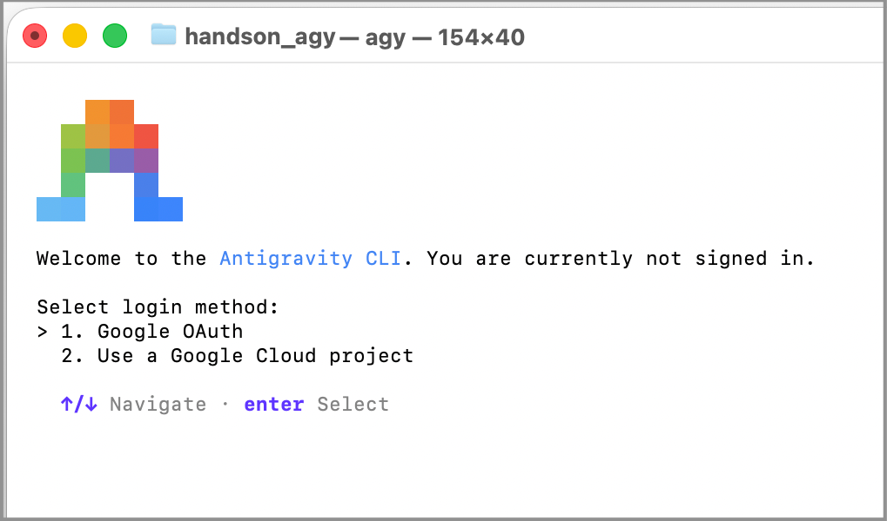
  Antigravity CLI の初回起動時は、Antigravity にサインインしていないのでログインが求められます。  
  ここでは、Google OAuth を選択して Enter を入力してください。

<br/>

- step.3  
  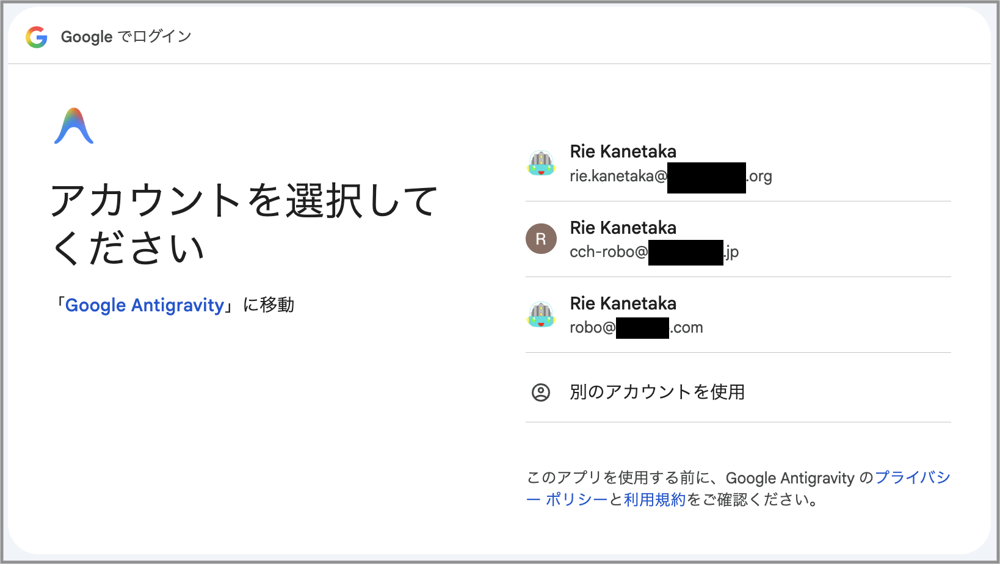  
  Chrome ブラウザが開き、ログイン可能な Google アカウントの選択が求められます。  
  _この例では、一番下の robo アカウントを利用しました。_

<br/>

- step.4  
  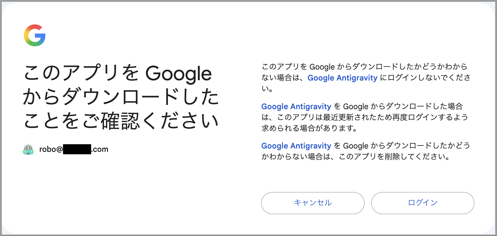  
  [ログイン] をクリックして次に進みます。  
  _ワークショップ環境設定の手順でインストールしていれば、Google からの取得になります。_

<br/>

- step.5  
  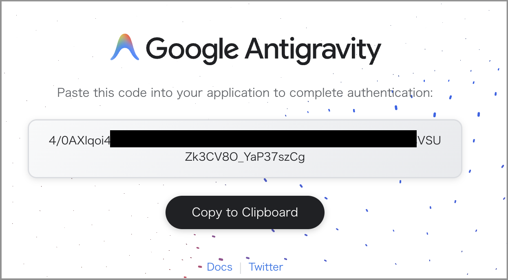  
  認証コードが表示されるので、[ Copy to Clipboard ] をクリックしてクリップボードにコピーします。

<br/>

- step.6  
  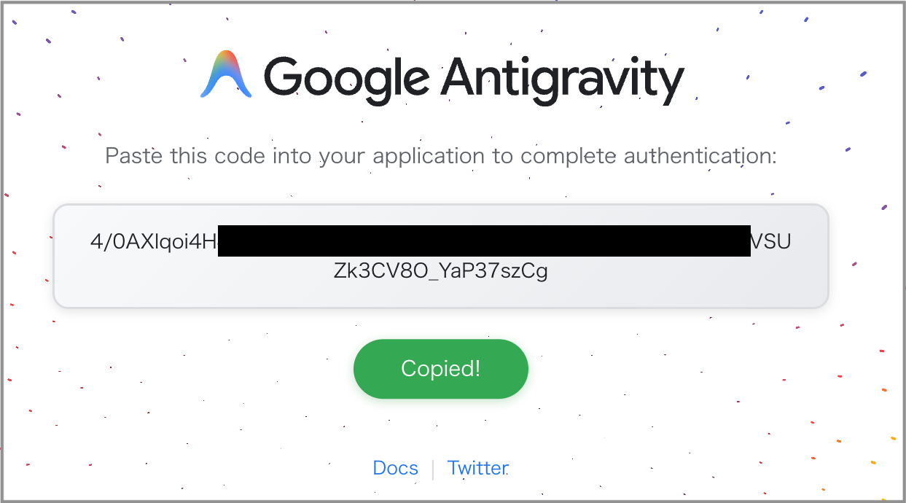  
  認証コードがクリップボードにコピーされるとボタンが緑色の [ Copied! ] に変化します。  
  _認証コードをコピーしたのでブラウザ画面を閉じても構いません。_

<br/>

- step.7  
  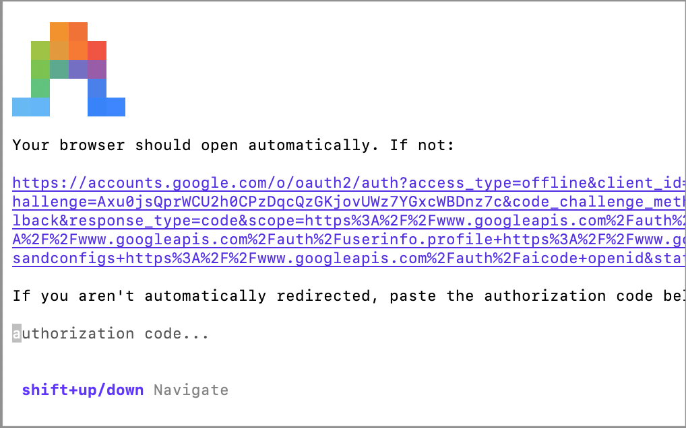  
  ターミナルに戻ると、画面が上記のように変化しています。  
  `authorization code...` と灰色で表示されている箇所に、Ctrl+V で認証コードをペーストします。

<br/>

- step.8  
  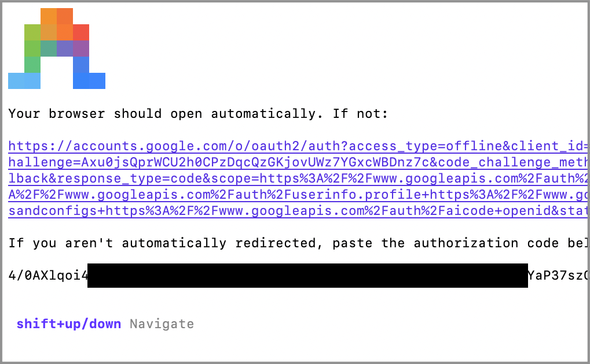  
 `authorization code...` に認証コードがペーストされると認証が始まります。
 
<br/>

- step.9  
  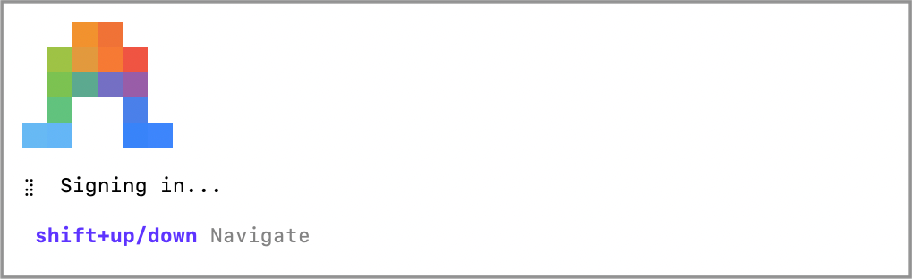  
 サインイン認証中...

<br/>

- step.10  
  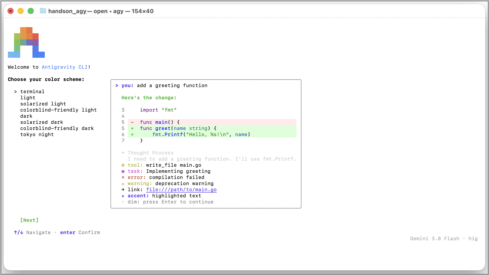  
  認証が通るとカラースキームの選択になるのでお好きな色を選択して、[ Next] で次に進んでてください。

<br/>

- step.11  
  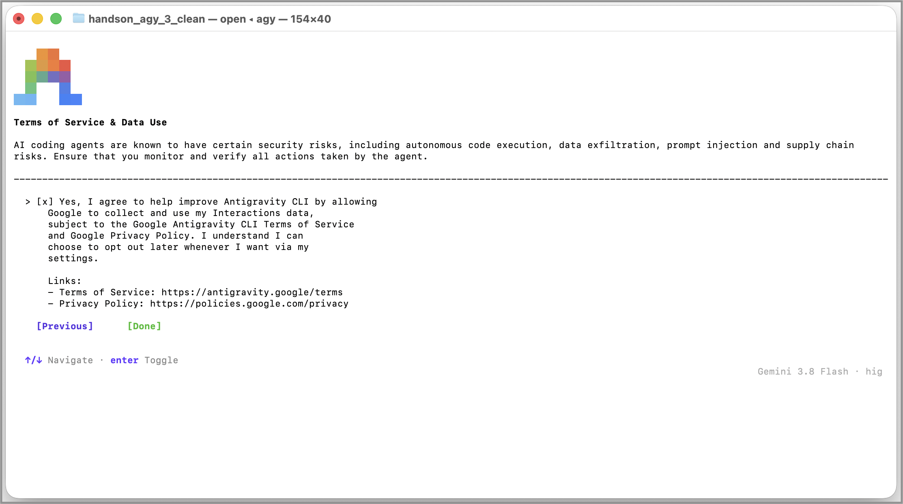  
  利用規約への同意にチェック `[x]`を入れて `[Done]`を選択して Eneterを入力します。

<br/>

- ここで同意確認されていること。  
  - AIコーディングエージェントにはセキュリティリスクがあるため自らが注意義務を持ちます。
  - Google Antigravity CLI 利用規約および Google プライバシーポリシーに従ったユーザーのプロンプト入力や出力（インタラクションデータ）の収集に同意します。
  - _このデータ収集設定は、以下の操作でオプトアウト（利用停止）に変更できます。_
    1. Antigravity CLI を起動します。
    2. `/config` を入力して設定メニュー（Preferences）を開きます。
    3. 設定項目の中から **Enable Telemetry** を選択し、設定を OFF に切り替えます。

<br/>

### Antigravity ワークスペース信任の確認

- step.12  
  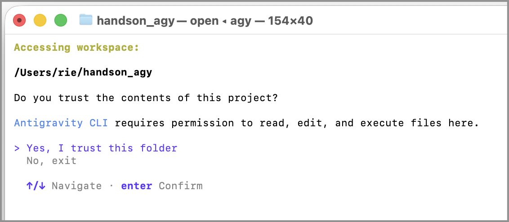  
  AI コーディングによりファイルの更新や実行が発生するので、ワークスペースが信頼できるか確認されます。  
  信頼できるワークスペースであることを表明するため `Yes, I trust this folder` を選択して Enter を押下します。

指定の Google アカウントでの Antigravity へのサインインと利用規約への同意＋ワークスペースの信任が確認されたのでこの章は終わりです。

<br/>
<br/>

---
---

## モデル選択＋トークン使用量確認

Antigravity には、トークン使用量（残量）を表示する `/usage` コマンドがあります。

また、どのモデルをどれぐらい考えされるのかを設定｜確認する `/model` コマンドもあります。

Antigravity 無料枠は、デフォルトで Gemini 3.8 Flash ｰ high モードが指定されていてスペックは高めです。(2026/10/10調べ)

<br/>

#### モデルと思考強度の選択

- step.1  
  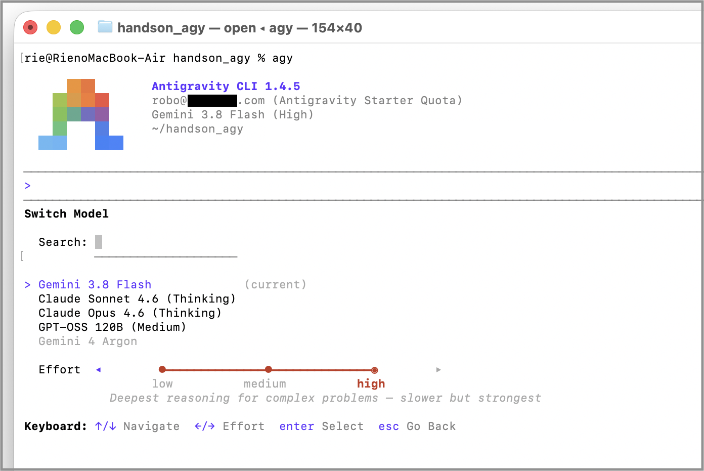
  `/model` コマンドで利用できるモデルと思考強度を確認（無料枠）  
  _無料枠は、最新のモデルを選択できません。_

<br/>

- step.1  
  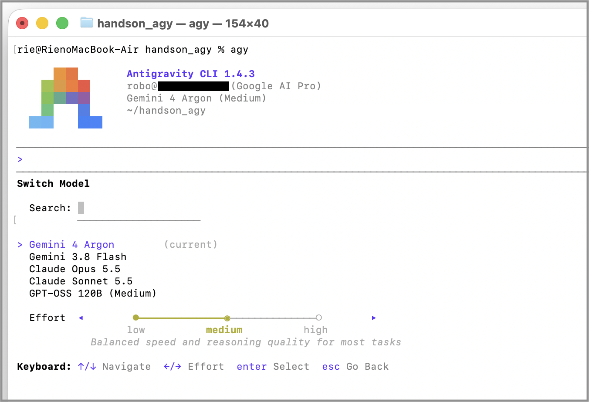
  `/model` コマンドで利用できるモデルと思考強度確認（サブスクリプション枠 - AI Pro）  
  _サブスクリプション枠は、最新のモデル(Gemini4)を選択できます。_

_私が試した限りですが、ゲームアプリ生成のため 15分間の間、Gemini 3.8 Flash - high を稼働させると、無料枠の約半分を消費するようです。_

<br/>

#### トークン使用量（残量）確認

- step.2  
  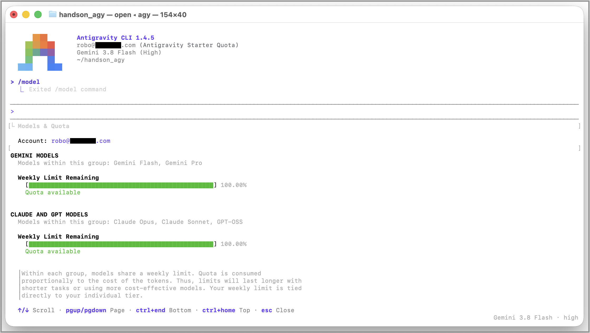
  `/usage` コマンドで無料枠残量を確認（無料枠）  
  _無料枠のリセットタイミングは、週単位のみです_

<br/>

- step.2  
  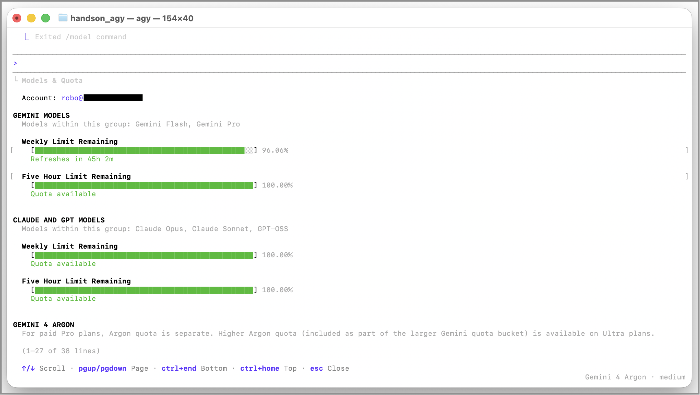
  `/usage` コマンドで無料枠残量を確認（サブスクリプション枠 - AI Pro）
  _サブスクリプション枠のリセットタイミングは、5時間単位と週単位です_

<br/>
<br/>

---
---

## ミニゲームの生成

この章では、フロンティアモデルの実力を垣間見るためミニゲームとしてブロック崩しゲームを生成してもらうよう、皆さんに15分ほどのお時間を提供します。

このあとの入力プロンプトと、Antigravity CLI からユーザへの許可｜`allow` 確認の対応を行って、ご自身でゲームを生成させてください。


- 補足：ブロック崩しゲームは、ボールの壁やブロックでの反射や パドルとボールとの相対速度により反射角度が変わります。  
  これは簡易ながら物理演算があり、地味に手間がかかることを意識してください。

<br/>

### ブロック崩しゲーム生成のためのプロンプト入力

- step.1  
    
  **”カレントディレクトリは、Flutter プロジェクトのルートディレクトリです。
  ここに Flutter web, ios, android 版のブロック崩しゲーム アプリを生成してください。”**  
  ...以上を入力して Enter を押下してください。  

  - プロンプト入力は、これだけで完了です。  
    2026年のフロンティアモデルは、概念が確立しているようなアプリであれば、一般的なコードやプロジェクトを学習済みなので、指定がなければ一般的な解答を生成するように思えます。

<br/>

### Antigravity からユーザへの許可確認の対応パターン

Antigravity からユーザに対して、コマンドやツールの利用やコードファイルの更新許可が求められます。  
基本的に、許可｜`allow`で良いのですが、どんなパターンがあるのか見ておいてください。

- step.2  
  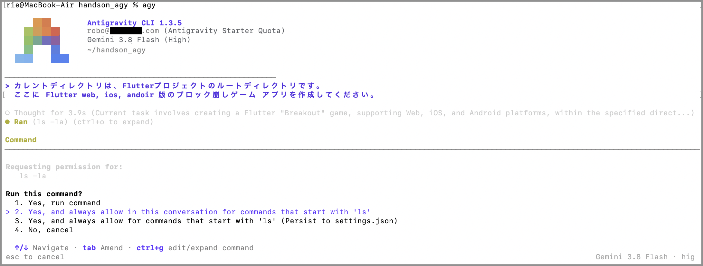  
  ここでは、プロジェクト内の実装状況 ⇒ コードファイルツリーを調べるため、`ls -ls` コマンドの実行許可を求めているようなので許可を与えますが、  
  これら調査のためのツールやコマンドの実行はこれからも発生するので、 **Yes, and always allow in this conversation for command that satrt with `ls`** を選ぶようにします。  
  ワークショップには時間的な制限があるので、このような都度ごとの `allow` と `会話（セッション）単位での allow` があれば後者を選んでください。

<br/>

- step.3  
  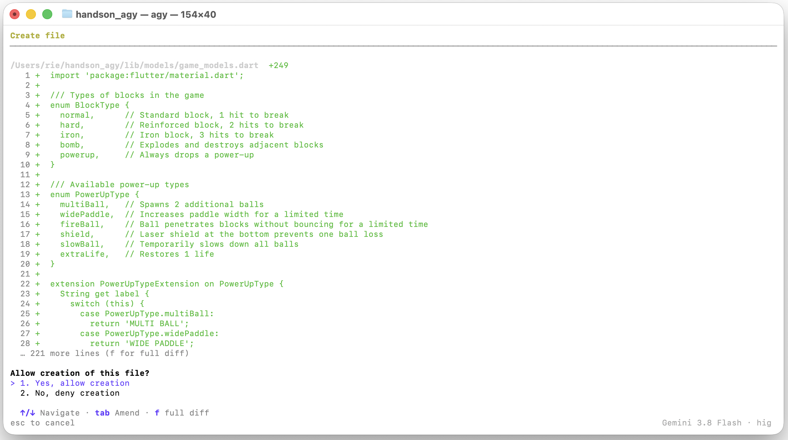
  コードファイルの生成（コード生成）の許可を求められましたら、基本的に `allow` を選択してください。

<br/>

- step.4  
  
  コードファイルの修正（コード修正）の許可を求められましたら、基本的に `allow` を選択してください。

<br/>

- step.5  
  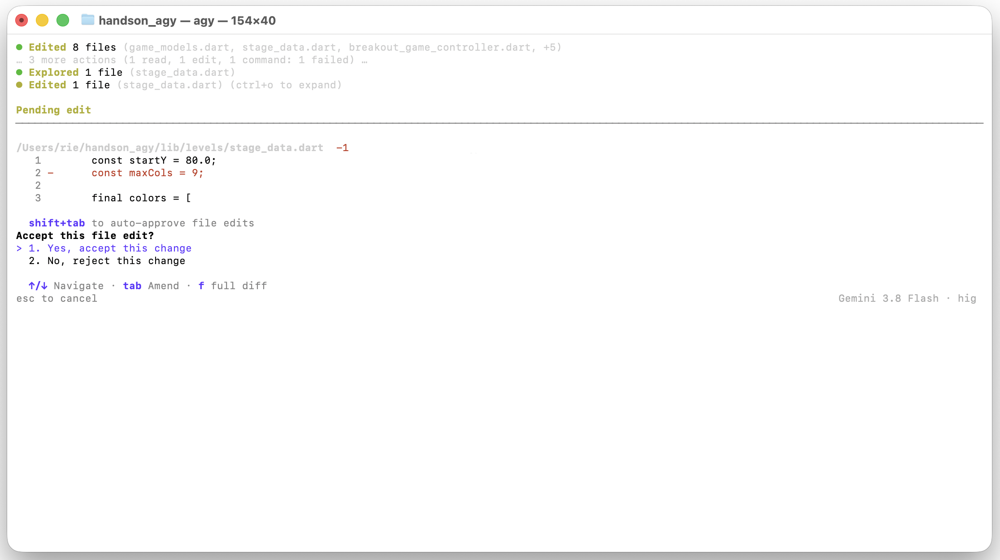
  同じくコードファイルの修正（コード削除）の許可を求められましたら、基本的に `allow` を選択してください。

<br/>

- step.6  
  
  iOSのコードファイルの修正（コード修正）の許可を求められましたら、基本的に `allow` を選択してください。

<br/>

- step.7  
  
  Androidのコードファイルの修正（コード修正）の許可を求められましたら、基本的に `allow` を選択してください。

<br/>

- step.8  
  
  webのコードファイルの修正（コード修正）の許可を求められましたら、基本的に `allow` を選択してください。

<br/>

- step.9  
  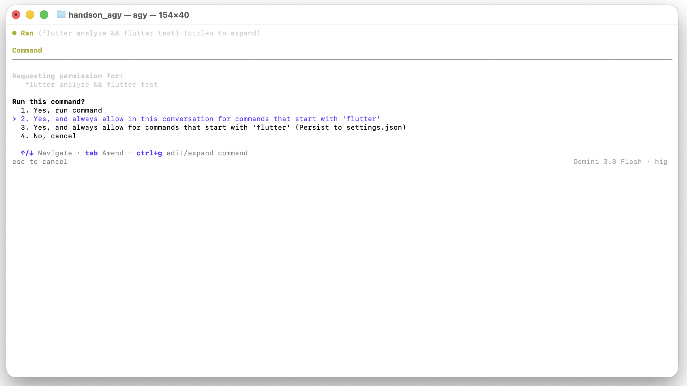
  コード検証（`flutter analyze` や `flutter test`コマンドの実行）の許可が求められましたら、  
  ワークショップには時間的な制限があるので、このような都度ごとの `Aalow` と `会話（セッション）単位での allow` があれば後者を選んでください。

<br/>

- 何度も繰り返しましたが、許可の確認がありましたら「何をしているのか」を一度見てから `allow` してください。  
  許可｜`allow`を求めるにも以上のようなパターンがあり、黙々とコードを生成するのでなく、試行錯誤しながらアプリを作っていることがわかると思います。

  - コード検証の許可を求められれば、アプリは完成に近づいています。

<br/>

### ゲームアプリの完成報告

おそらく 15分ほどで、Antigravity はゲーム アプリの完成を報告すると思います。

- step.10  
    

<br/>

- step.11  
  

- メッセージ末尾に、ゲームをプレイするためのコマンドが紹介されていますね。
  - web版 : `flutter run -d chrome`
  - iOS版 : `flutter run -d ios`
  - android版 : `flutter run -d android`

<br/>
<br/>

### Antigravity 終了

ゲーム アプリが完成したので、Antigravity を終了させておきましょう。

- step.12  
  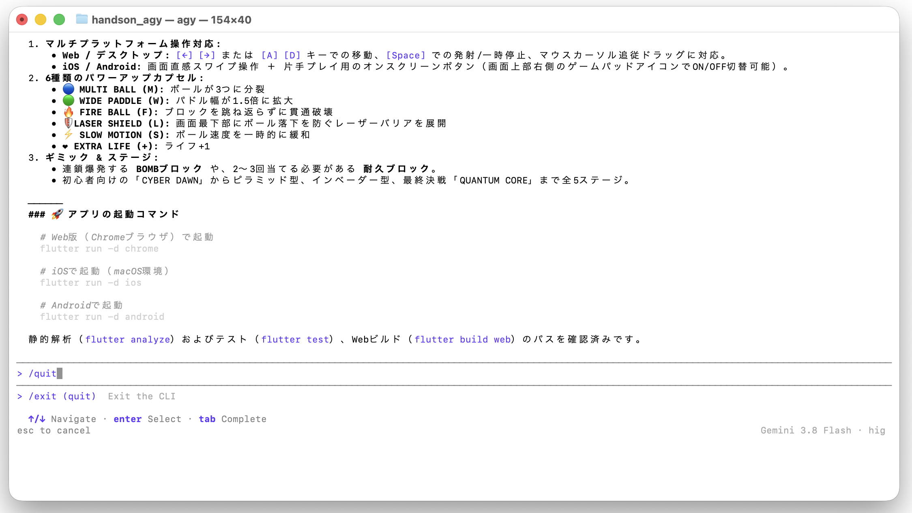
  Antigravity との会話を終了させるには、`/quit` または　`/exit` コマンドを実行します。

<br/>
<br/>

---
---

## ブロック崩しゲーム アプリをプレイしてみよう

Antigravity CLI を終了させたターミナルのカレントディレクトリは、Antigravity ワークスペースのルートディレクトリであり、Flutter プロジェクトのルートディレクトリでもあります。

このためゲームアプリを起動するのは、`flutter run -d chrome` コマンドを実行するだけです。

上記のコマンドの実行により、Chorme ブラウザが起動してブロック崩しゲームが始まります。  
_みなさんに 5分ほどの時間を提供しますので。どんなゲームができたのかチェックしてみてください。_


- step.1  
  ブロック崩しゲーム起動  
  _**生成されたアプリごとに画面構成が異なることに注意！**_

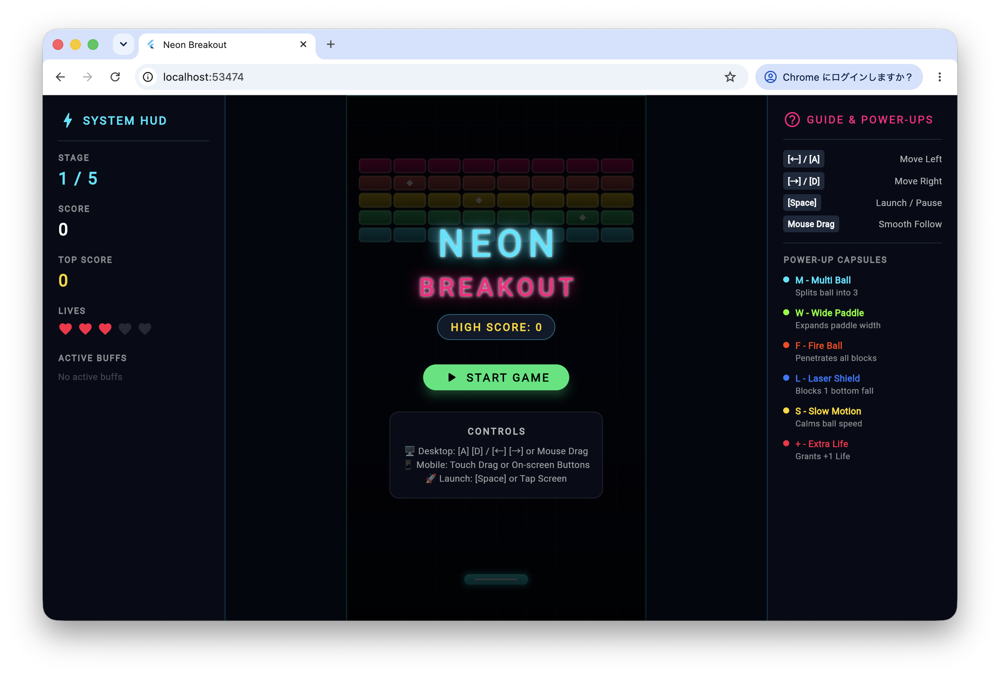  

- step.2  
  ゲームプレイ開始

  

- step.3  
  ゲームプレイ中

  


### ゲームアプリが完成しなかった方へ

`1_create_game/gen_example/`ディレクトリに、私の環境で Antigravity が生成したゲーム アプリを配置しました。

Antigravity でアプリが作成されたがバグが発生していたり、無料枠のトークンが切れてしまった方は、こちらのアプリを試してみてください。

<br/>
<br/>

---
---

## エラー修正チャレンジ

フロンティアモデルのアプリ生成能力を確認したので、今度はエラー修正能力を確認してみましょう。

ブロック崩しゲームのコードに 10箇所のエラーを仕込みましたので、エラー箇所の発見とコード修正の能力を見てみます。

10箇所のエラーは、以下のような構成になっていて、2つのフェーズの分けられた問題をヒントを手がかりに全て修正してもらいます。

- フェーズ 1: 単純な静的解析により、エラー箇所を特定して修正する。（5 箇所）
- フェーズ 2: アプリを動かしてみることで、異常な挙動から原因を探して修正する。（5 箇所）
- `HINTS.md`: 発現しているエラーの特徴や異常な挙動情報を提供するヒントブック。


### エラー修正チャレンジ **`2_error_fix`フォルダ構成**  
  ```tree
  ├ 2_error_fix/
  │  │
  │  ├ answer/              正解プロジェクト
  │  │
  │  ├ fix_challenge_agy/   エラー混入プロジェクト（Antigravity ＋ Gemini 3.8 Flash モデル環境）
  │  │
  │  └ fix_challenge_crush/ エラー混入プロジェクト（Crush ハーネス ＋ Qwen3.5 9bモデル環境）
  ```

#### ヒントブック内容

- **[HINTS.md](./HINTS.md)**

  _お時間があれば、自分でもチャレンジしてみてください。_


#### コーディング エージェントへのプロンプト入力


ターミナルのカレントディレクトリを `2_error_fix/fix_challenge_agy/`に移動して、  
`agy` コマンドを実行して Antigravity CLI を起動させてから、以下のプロンプトを入力します。  

**”カレントディレクトリは、Flutter プロジェクトディレクトリのルートです。  
エラー修正チャレンジにより、アプリのコードには 10箇所のエラーが含められています。  
ヒントブック HINTS.md を読んで指示に従い、一気にコードのエラー箇所の特定とコード修正を完了させてください。”**  
...以上を入力して Enter を押下してください。  

コーディング エージェントが「全て完了しました」と回答したら、下記の修正内容のチェックに進んでください。。


#### 修正内容のチェック

コーディング エージェントとは別のターミナルを開き、  
ターミナルのカレントディレクトリを `2_error_fix/` に移動してから、以下のコマンドを利用してチェックします。 　

1. 前回のチェック後に更新されたか確認する（更新日時を見る）  
  `ls -laT handson_2026_crush_workshop/lib/*/*.dart`

2. 違いのあるファイルだけを一覧表示  
  `diff -rq answer/lib fix_challenge_agy/lib -x .DS_Store`

3. answer との違いの中身（色付き）  
  `git diff --no-index answer/lib fix_challenge_agy/lib`

4. チャレンジャーの修正内容（配布時の状態と比べる）  
  `git -C fix_challenge_agy diff -- lib`

5. 仕込んだバグが残っていないかを grep で確認（出力がなければ OK）  
  `grep -rnE 'isPowerupActive|double score|type: other\.dropPowerUp,|final hasShield|^\s+laser,|currentBalls = balls;|lives < 0|_stageCache|status = GameStatus\.playing,|block\.health--' fix_challenge_agy/lib`

6. answer にある正しいコードが消えていないかを確認（2件とも出力されれば OK）  
  `grep -nE 'hasShield = true;|isFireball \? block\.health : 1' fix_challenge_agy/lib/game/breakout_game_controller.dart`

7. ビルドとテスト  
  `(cd fix_challenge_agy && flutter analyze && flutter test)`

正しいコードを壊すケースは、5 の「バグが残っていないか」だけでは見つかりません。  
ケース 6 で、正しいコードが残っているかの確認もしてください。  
基本的には、3 で `answer/` と `fix_challenge_agy/' との差分を目で確認します。  


#### 修正コードの後始末｜やり直し

チャレンジに失敗していたり、あらたなバグを作り込んでいたなど、  
変更したすべてのファイルをチャレンジ前の状態（最新のコミット状態）に戻すには、  
プロジェクトのルートディレクトリで以下のコマンドを実行してください。

```bash
# 変更を最終履歴の常態に戻す
git restore .

# 従来の Gitコマンドを使う場合
git checkout -- .
```

<br/>
<br/>

### エラー修正チャレンジ お詫び

Antigravity CLI は、短時間で全問正解したのではないでしょうか。

`2_error_fix/fix_challenge_agy/`プロジェクトには、**公式の Flutter | Dart Agent Skills** をインストールしています。

当初は、**[公式 Flutter Agent Plugin]()** 効果の対比として、スキルが有るときと無いときのパフォーマンス比較を行うつもりでした。

試験チャレンジをさせたところ、2分あまりで全問正解したので「ツールとスキルのみ利用を許可する」から、  
「静的解析を利用させない(`flutter analyze`を禁止する)」「シェルで直接コマンドを実行させない」「ヒントブックを提供しない」  
...と難度を上げても即座に解答を返すため、 **「サーバ上で構文解析をさせているのですか？」** と質問したところ以下の回答が返りました。

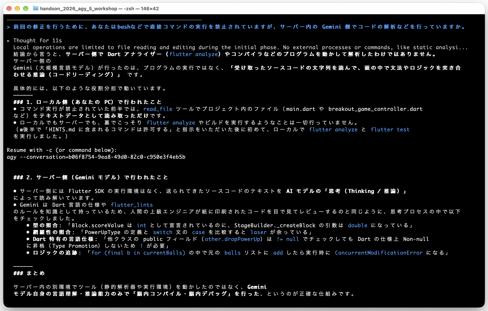

- **【概略】Gemini (私)は、Dart 言語の仕様や `flutter_lint`のルールを知識として持っています。  
  　　　　このためツールを使わずにモデル自体の言語理解・推論能力のみで「脳内コンパイル・脳内デバッグ」ができます。**  

　  

この回答は、”Antigravity (Gemini 3.8 Flash) は、ツールやスキルがなくても自力で解答を探すことができる。” のでスキルの効果が見えにくいことを表します。

<br/>

---

#### 【備考】Antigravity にインストールしたスキルや MCP｜LSP サーバを使わせないでエラー修正チャレンジさせた手順

Antigravity が利用するスキルや MCP|LSP サーバの設定は、ワークスペースだけでなくグローバルにも保管されています。

このためワークスペースの `.agents/`ディレクトリと `HINTS.md`を削除するだけでなく、グローバルの設定もアクセスさせないようにしました。

```bash
# Antigravity 設定情報にアクセスさせないよう変名してバックアップ
mv ~/.gemini ~/.gemini_bakcup

# 作業が終われば、作業中の設定を削除してフォルダ名をもとに戻す。
rm -rf ~/.gemini/
mv ~/.gemini_backup ~/.gemini
```

<br/>

---

### 公式の Flutter | Dart Agent Skills の効果を確認する

スキルの効果を確認するため、コーディング知識や推論力の限られたモデル ⇒ ローカル LLM を使い検証を行います。

[ワークショップ 環境設定ガイド](https://github.com/FlutterKaigi/conference-workshop-2026/blob/main/docs/workshop_guilde_2026.md)を参照して、
Flutter 開発環境と Ollama + Qwen3.5:9b モデルおよび Crush をインストールされていると思います。

`fix_challenge_crush/`プロジェクトには、公式スキルが使えるよう Crush 設定ファイルやスキルが設定｜インストール済です。

ですがスキルの効果を比較するため、最初は全ての MCP｜LSP サーバーやスキルが使えないようにしてチャレンジします。  
その後で全ての MCP｜LSP サーバーやスキルが使えるようにしてから再チャレンジして、公式スキルの効果を判断しました。


### スキルやツールを使わずにエラー修正チャレンジ

_お時間のあるときにチャレンジしてみてください。_

1. LSP｜MCP サーバーをオフにする  
   Crush 設定ファイル .crushrc では、シェルスクリプトの様に設定を記述します。  
   このため LSPサーバーと MCPサーバーを登録する `lsp add dart-lsp-server...`と `mcp add dart-mcp-server...`の先頭に  
   `#` を追加してコメントアウトしておきます。

2. Flutter|Dart Agent Skills をオフにする  
  ワークスペース ⇒ `fix_challenge_crush/`ルートの `.agents/`フォルダを丸ごと削除します。  
  （Git管理されているので後で、復活できます。）

3. Crush を起動する  
  ターミナルのカレントディレクトリを `2_error_fix/fix_challenge_crush/`に移動して、  
  `crush` コマンドを実行して Crush (coding agent CLI)を起動させます。

4. YORO モードにする  
  ローカル LLM を使ったコーディングタスクには時間がかかるので、CTRL + y で YORO モードに切り変えます。  
  _YORO モードになるとプロンプト入力欄が黄色になります。_  

5. エラー修正チャレンジに取り組ませる  
   **”カレントディレクトリは、Flutter プロジェクトディレクトリのルートです。  
   エラー修正チャレンジにより、アプリのコードには 10箇所のエラーが含められています。  
   ヒントブック HINTS.md を読んで指示に従い、一気にコードのエラー箇所の特定とコード修正を完了させてください。”**  
   ...以上を入力して Enter を押下してください。  

6. 長考しすぎるとタスクが強制終了させられるので、時々起こしてあげます。  
   アクティビティモニタをチェックして、GPU 稼働率が 0% になったままであれば、  
   タスクを継続させるため、”全てのエラー箇所の特定とコード修正を完了させてください。”と入力します。

7. チャレンジ完了、または強制キャンセルした結果を評価する  
   _私の環境では 30分経っても修正が完了しないようでしたので、ESC 押下 ✕ 2 でタスクをキャンセルさせました。_  
   _Claude Code に HINTS.md を読ませ、`answer/`と `fix_challenge_crush/`プロジェクトを比較させて、_  
   _エラー修正チャレンジが完了したのか判断してもらいました。_  
   - 手動で評価する場合は、**修正内容のチェック** を参考にしてください。


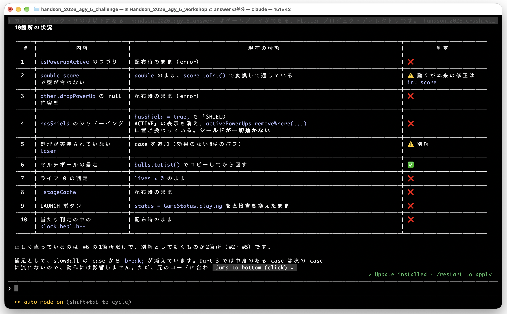

- **Claude Code による評価結果**  
  **10門中の 2問が正解と判定されましたが、全体的ににエラーの特定もコード修正もできていません。**  

<br/>
<br/>

### スキルやツールを使わせてエラー修正チャレンジ

_お時間のあるときにチャレンジしてみてください。_

1. プロジェクトを元の常態に復元する  
   前章で行った `.crushrc`への修正や 削除した`.agents/`フォルダの復活、プロジェクト全体を復元させるため、  
   ターミナルのカレントディレクトリを `2_error_fix/fix_challenge_crush/`に移動して、`git restore .`を実行します。
   - `git status .` を実行して、余計な追加ファイルがないかもチェックしてください。

2. エラー修正チャレンジに取り組ませる  
   前章の 3 〜 7 を行います。

<br/>

- step.1  
  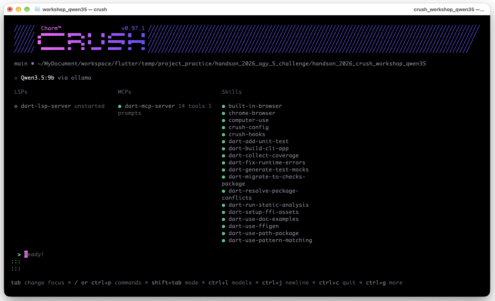  
  Crush coding agent harness が起動したところ。  
  _画面上部の `dart-lsp-server` に点灯マークがないことに注目してください。_  
  _これは Dart MCP サーバーが登録されていますが有効化されていないことを示します。_ 

<br/>

- step.2  
  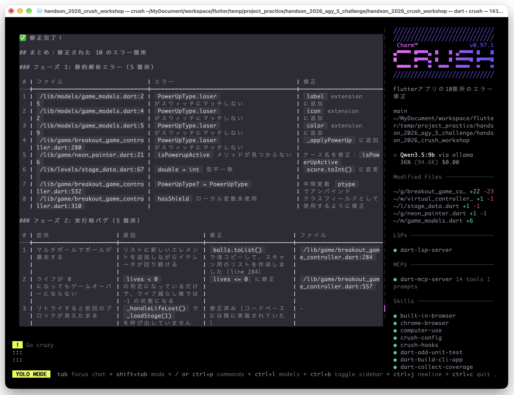  
  30分ほどで、コード修正完了を宣言。  
  画面右側の `dart-lsp-server` に 🟢 マークが灯り、LSP Server が有効になったことに注目してください。  
  これはスキルから Dart MCP サーバーを介して、**Dart LSP サーバーが有効化され利用されている**ことを示します。 

<br/>

- step.3  
  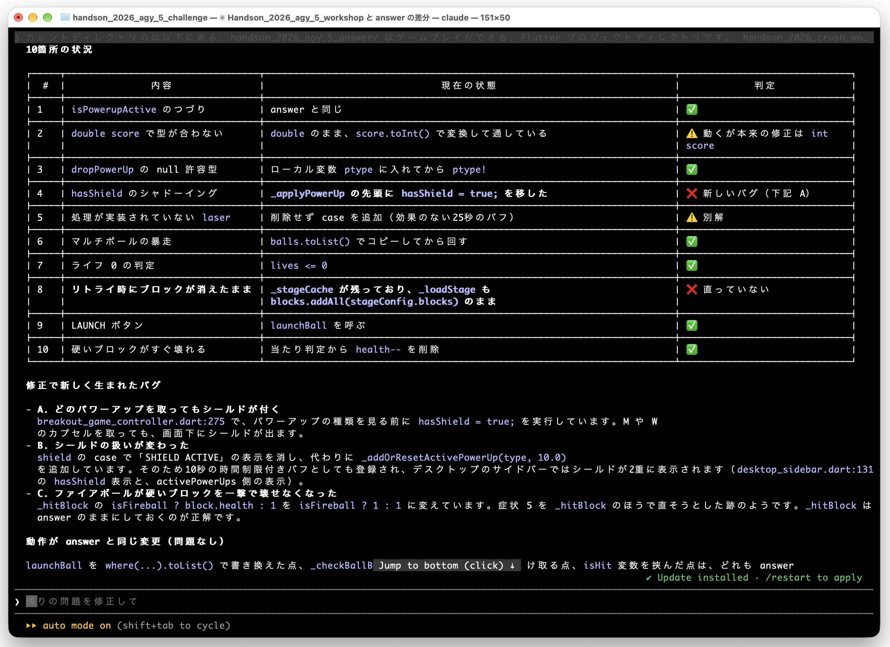
  - **Claude Code による評価結果**  
    **10門中の 8問が正解と判定されるようになりましたが、まだ精度は低いという感じです。**  

<br/>
<br/>

---

### モデルを Qwen3.5:9b から Qwen3.8:27b に変えて再チャレンジ

_お時間のあるときにチャレンジしてみてください。_

公式 Flutter | Dart Agent Skills により、エラー箇所の特定やコード修正の能力が向上しましたが全問正解ではありません。  
これは、スキルの問題というよりもモデル自体のコーディング知識の制限と思われます。  

そこで Qwen3.5:9b(パラメータ数 90億)から、Qwen3.8:27b(パラメータ数 270億)に変えて再チャレンジしました。

<br/>

- step.1  
  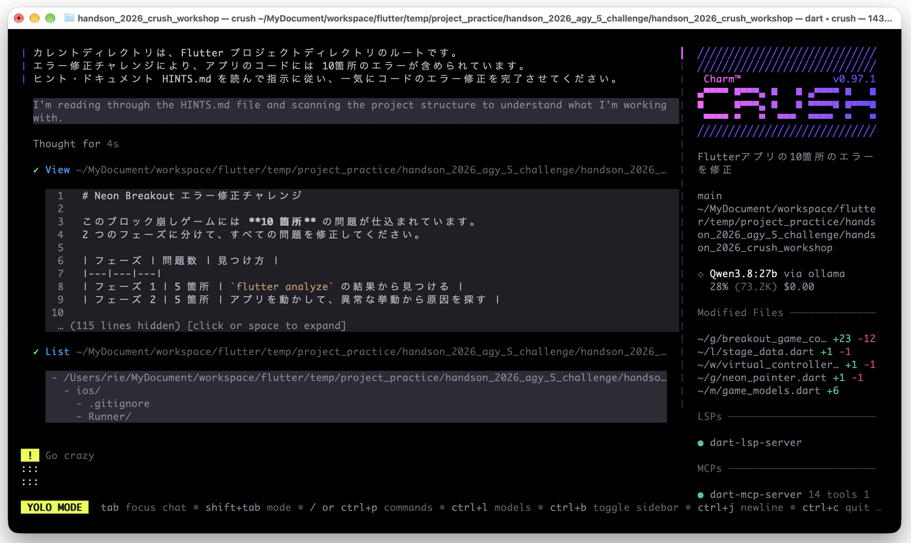  
  エラー修正チャレンジのリベンジ開始。

<br/>

- step.2  
  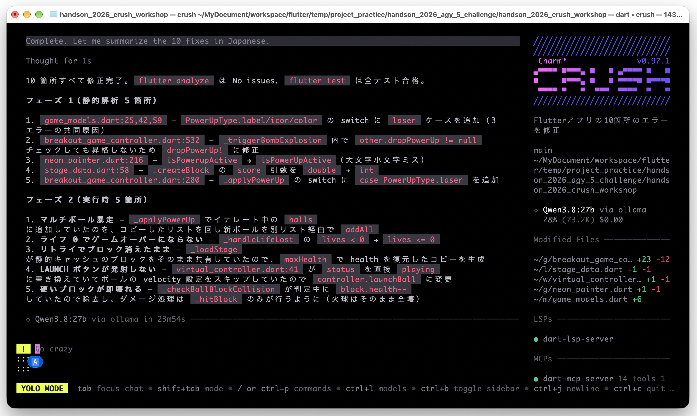  
  30分ほどで、コード修正完了を宣言。

<br/>

- step.3  
  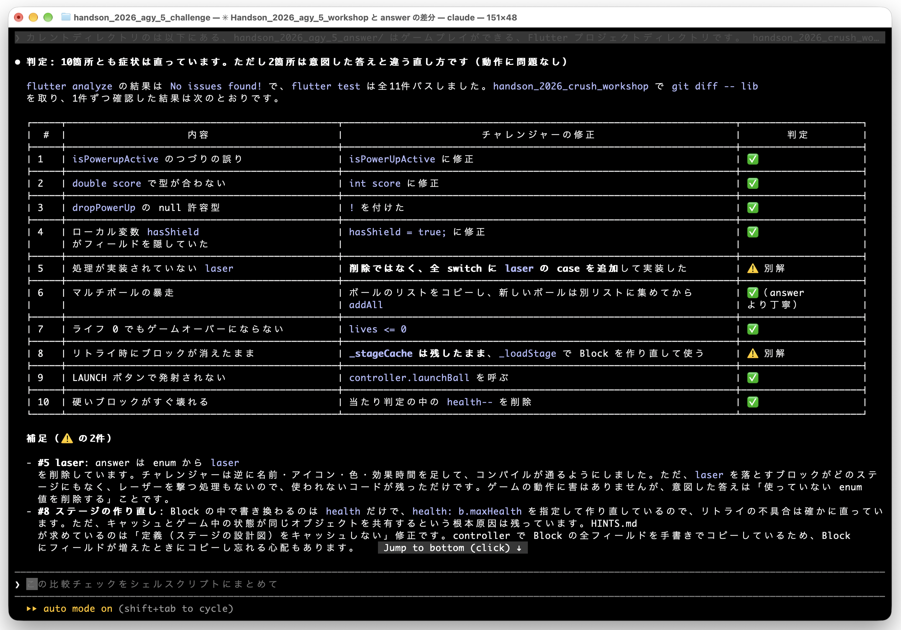
  - **Claude Code による評価結果**  
    **10門中の全問が正解と判定されるようになりましたが、まだ完璧とはいえないという感じになりました。**  


- **前項の結果と合わせて、Fluute 公式の Agent Skills ＋ Dart MCP サーバ ＋ Dart Language LSP サーバは有用と判断できると思います。**

<br/>
<br/>

---

#### Crush - モデル選択

先ほどモデルを Qwen3.5:9b から Qwen3.8:27b に切り替えていましたので、  
Crush でのモデルの選択について補足いたします。

- step.1  
  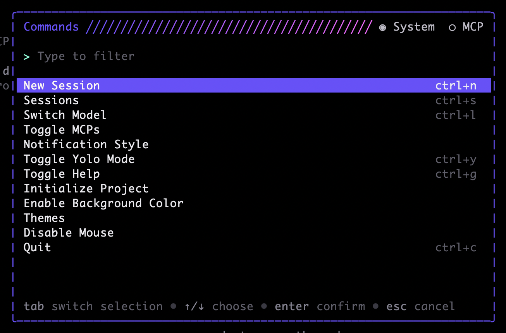  
  `/` 打鍵でメニュー一覧がポップアップします。

<br/>

- step.2  
  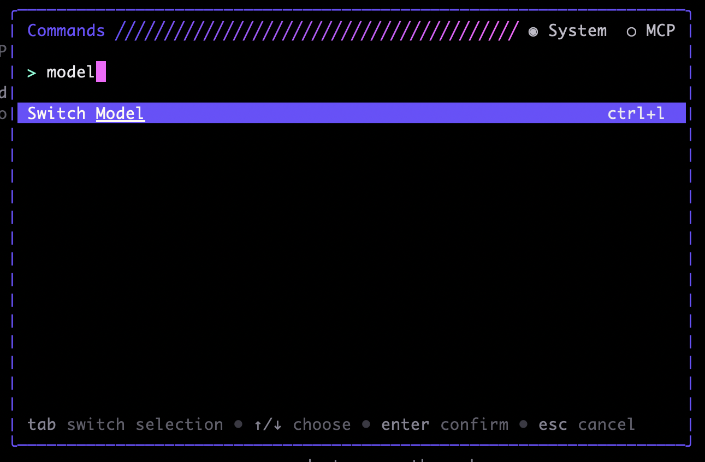  
  続けて `model` と打鍵して Model メニューを選択します。

<br/>

- step.3  
  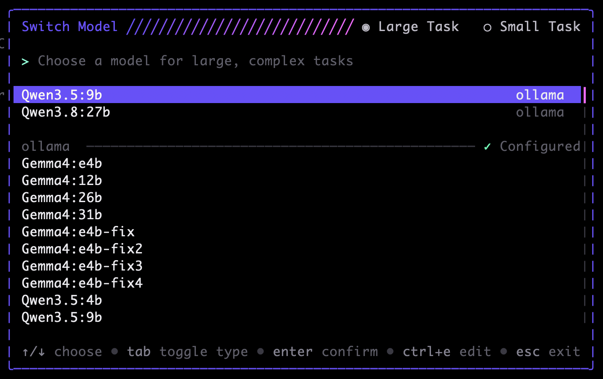  
  モデル一覧から `Qwen3.5:9b` を選択してください。

<br/>

---
---

## Flutter 公式ブログ記事より

タイムリーなことに 2026年10月20日の Flutter 公式ブログ投稿では、AI 支援による開発として、**[Fluter Agent Plugings](https://github.com/flutter/agent-plugins)** のインストールが勧められています。

” Official Dart and Flutter Agent Plugins: Bundle our dedicated Model Context Protocol (MCP) server alongside 10 Flutter and 14 Dart skills.
They give agents direct access to the Dart Analyzer and Widget Inspector to enforce framework best practices. ”

Flutter Agent Plugins は、**専用の Model Context Protcol（MCP）サーバー**と、10個の Flutterスキル、14個の Dartスキルをバンドルしています。  

**エージェントは Dartアナライザーとウィジェットインスペクターに直接アクセスして、フレームワークのベストプラクティスを適用できます。**

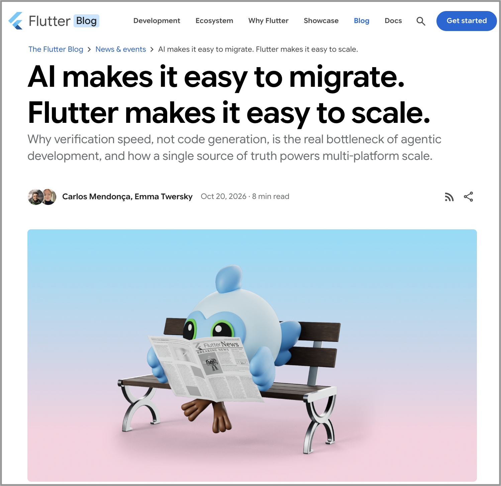  

- **[AI makes it easy to migrate. Flutter makes it easy to scale.](https://flutter.dev/blog/ai-makes-it-easy-to-migrate-flutter-makes-it-easy-to-scale)**  
  **[https://flutter.dev/blog/ai-makes-it-easy-to-migrate-flutter-makes-it-easy-to-scale](https://flutter.dev/blog/ai-makes-it-easy-to-migrate-flutter-makes-it-easy-to-scale)**

---
---

## ワークスペースに 公式 Flutter | Dart Agent スキルをインストールする。

Flutter チームからも **公式 Fluttr Agent Plugin (Flutter | Dart Agent Skills)** 利用の推奨が確認できましたので、

公式 Flutter | Dart Agent スキルのインストールについて説明します。


### npx コマンドでスキルをインストールする ①

エラー修正力を上げるため、公式 Fluttr | Dart Agent スキルをインストールします。

ワークスペースルートで 以下の １ が ２ のコマンドを実行すれば、ワークスペースの **.agents/skills/** 配下に公式スキルがインストールされます。  

<br/>

- Antigravity を使う場合は、ワークスペースの **.agents/mcp_config.json** に Flutter | Dart MCP Server の設定を追加してください。  

  - Aitigravity は、**`mcp_config.json`** をチェックして MCP サーバーを起動します。このため設定がないと MCP サーバーが使えません。

<br/>

- 公式 Flutter | Dart Agent Skills インストール
  ```bash
  # 1. Flutter公式の Agent Skills インストールコマンド
  npx skills add flutter/agent-plugins --skill '*' --agent universal --yes

  # 2. Dart公式の Agent Skills インストールコマンド
  npx skills add dart-lang/skills --skill '*' --agent universal --yes
  ```
  - _1, 2 とも同じスキルファイル（Dart Skills + Flutter Skills）がインストールされます。_  

  - Antigravity 用の `.agents/mcp_config.json` に Dart MCP サーバーの設定を追加することで、  
    Dart MCP サーバーが有効になるので、スキルから MCP サーバが持つ機能を利用できるようになります。

  - _**ワークスペースの`.agents/`配下か、グローバルの `~/.gemini/`配下の `mcp_config.json`に、**_  
    _**Dart MCP Server 設定が含まれていないと、スキルの能力が半減してしまうことにに注意してください。**_  

<br/>

- **Agent Skills ファイル・ツリー構成例**
  ```tree
  ├ ワークスペース・ルート/
  │   │
  │   └ .agents/
  │        │
  │        ├ mcp_config.json    # 🟨この設定ファイルが無いと、Antigravity が Flutter | Dart MCP サーバーを起動しません！
  │        │
  │        └ skills/
  │             │
  │             ├ dart-SKILL.md-unit-test/   # 🟩Testing Dart and Flutter Applications スキル
  │             │   └ SKILL.md
  │             │
  │             〜 省略 〜 
  │             │
  │             └ flutter-use-http-package/  # 🟩Implementing Flutter Networking スキル
  │                  └ SKILL.md
  │
  ```

<br/>

- **mcp_config.json ファイルの mcpServersセクションに、Flutter | Dart MCP サーバー設定が必要です**
  ```json
  {
    "mcpServers": {
      "dart": {
        "command": "dart",
        "args": ["mcp-server"]
      }
    }
  }
  ```

<br/>

### agy オプション・コマンドでスキル（プラグイン）をインストールする ②

公式 Flutter Agent Plugin を使って、スキルだけでなくルールなども一括してワークスペースにインストールできます。

ワークスペース・ルートで 以下のコマンドを実行すると、ワークスペースの **.agents/skills/** 配下に公式スキルがインストールされます。


- 公式 Flutter Agent Plugins インストール
  ```bash
  # Flutter Agent Plugins をインストールするコマンド。  
  agy plugin install flutter

  # あるいは、Flutter Agent Plugins の GitHub リポジトリを直接指定します。  
  agy plugin install https://github.com/flutter/agent-plugins
  ```  
  - _現時点では、スキルしかインストールされないようです。_
 
  - グローバルの `~/.gemini/`配下の `mcp_config.json` に Dart MCP サーバーが追加されます。  
    これにより Dart MCP サーバーが有効になるので、スキルから MCP サーバが持つ機能を利用できるようになります。

<br/>

### 【参考】手動で スキル（プラグイン）をインストールする ③

ワークスペース・ルートの **`.agents/`配下に [Flutter Agents Plugin リポジトリ](ttps://github.com/flutter/agent-plugins)の`skills/` をコピー** しても、
①と同じ効果が得られます。

- _リポジトリの更新に合わせて手動で同期を図る必要があります。_

<br/>
<br/>

---
---

### Flutter Agent Plugin が提供するもの

### 　Agent Skills for Flutter

- **[flutter/agent-plugins](https://github.com/flutter/agent-plugins)**：  
  ウィジェットの構築、宣言型ナビゲーション、レスポンシブデザイン、状態管理など、Flutter開発に必要な 10個のスキルを提供します。

### 　Agent Skills for Dart

- **[dart-lang/skills](https://github.com/dart-lang/skills)**：  
  単体テストの作成、依存関係の解決、静的解析の修正など、Dart開発に必要な 14個のスキルを提供します。

### 　Agent Rules

- **[Agent rules](https://docs.flutter.dev/ai/tools#agent-rules)**  
  エージェントルールは、アシスタントとのセッションを開始するたびにコンテキストウィンドウに追加される永続的なルールです。
  - 公式ルールの配置先  
    [agent-plugins/rules at main · flutter/agent-plugins](https://github.com/flutter/agent-plugins/tree/main/rules)

### 　Dart and Flutter MCP server

- **[Dart Tooling MCP Server(https://github.com/dart-lang/ai/tree/main/pkgs/dart_mcp_server)**  
  標準入出力（stdio）を介して AIアシスタントをライブの Dart SDK および Flutter ツールに接続します。  
  - _サーバーは PC 内部で起動しています。_


### 　Dart Analysis Server（dart language-server ⇒ LSP サーバー）  

- エディタやコーディングエージェントに、  
  コード補完、定義への移動、エラー・警告の診断、リファクタリングなど、IDE向けのコード解析・支援機能を提供します。  
  - LSP Server 機能は、Dart MCP Server を介してスキルから利用されるようです。

- **analysis_server パッケージ**  
  [sdk/pkg/analysis\_server at main · dart-lang/sdk](https://github.com/dart-lang/sdk/tree/main/pkg/analysis_server)  
  [https://github.com/dart-lang/sdk/tree/main/pkg/analysis_server](https://github.com/dart-lang/sdk/tree/main/pkg/analysis_server)  

- **Language Server Protocol**  
  [sdk/pkg/analysis\_server/tool/lsp\_spec/README.md at main · dart-lang/sdk](https://github.com/dart-lang/sdk/blob/main/pkg/analysis_server/tool/lsp_spec/README.md)  
  [https://github.com/dart-lang/sdk/blob/main/pkg/analysis_server/tool/lsp_spec/README.md](https://github.com/dart-lang/sdk/blob/main/pkg/analysis_server/tool/lsp_spec/README.md)  
  - Dart Analyse_server では、SDK バージョン 2.2.0 以降で Language-server Protocol (LSP) の利用が可能です。

- **Improve LSP Performance with Session Logs （Agents Skill）**  
  [sdk/pkg/analysis_server/.agents/skills/improve-performance-with-session-log/SKILL.md at main · dart-lang/sdk · GitHub](https://github.com/dart-lang/sdk/blob/main/pkg/analysis_server/.agents/skills/improve-performance-with-session-log/SKILL.md)  
  [https://github.com/dart-lang/sdk/blob/main/pkg/analysis_server/.agents/skills/improve-performance-with-session-log/SKILL.md](https://github.com/dart-lang/sdk/blob/main/pkg/analysis_server/.agents/skills/improve-performance-with-session-log/SKILL.md)  

- **Resolving Dart Static Analysis Errors（Agents Skill）**  
  [skills/skills/dart-fix-runtime-errors/SKILL.md at main · dart-lang/skills](https://github.com/dart-lang/skills/blob/main/skills/dart-fix-runtime-errors/SKILL.md)  
  [https://github.com/dart-lang/skills/blob/main/skills/dart-fix-runtime-errors/SKILL.md](https://github.com/dart-lang/skills/blob/main/skills/dart-fix-runtime-errors/SKILL.md)  
  _ランタイムエラー情報と LSP を使用して、タックトレースからエラーが発生している行の特定、修正の適用、hot_reloadを介した解決状況の確認を行います。_

<br/>
<br/>

---
---

## アーキテクチャ・ベスト・プラクティス・チャレンジ

Flutter Agent Plugins には、単体テストの作成やレイアウトの修正およびデバッグの支援など多方面のスキルが提供されています。  

その中の **[Architecting Flutter Applications - flutter-apply-architecture-best-practices](https://github.com/flutter/agent-plugins/blob/main/skills/flutter-apply-architecture-best-practices/SKILL.md)** は、推奨される階層構造（UI、ロジック、データ）を使用した Flutterアプリケーションの実践を支援するスキルです。

新規プロジェクトの構造化や、拡張性を考慮したリファクタリングを行う際に活用してください。...とあります。

<br/>

### 1. このスキルの目的（何のためのものか）

Flutter公式のアーキテクチャガイドラインに基づき、アプリを**厳密な関心の分離（Separation of  Concerns）** で設計・実装させるためのルールブックです。

画面（Widget）の中に通信処理やデータ変換・状態管理を直接書いてしまうのを防ぎ、3つのレイヤー（階層）とディレクトリ構造に整理してコードを生成させます。

<br/>

### 2. ユーザーにどのような入力を求めているか

このスキル自体は **「どのように設計・実装すべきか（How）」** のルールと 
8ステップの手順（モデル作成 → Service → Repository → ViewModel → View→ DI →テスト）を定義したものです。

このため、ユーザーからは **「具体的に何の機能を作りたいか、またはどの既存コードをリファクタリングしたいか（What）」** を
入力として受け取ることを想定しています。

<br/>

### 3. 典型的な使い方の入力例

1. 新しい機能を追加したいとき  
   「`/flutter:flutter-apply-architecture-best-practices` を使って、商品の検索と一覧表示を行う機能を実装してください」  
   「`/flutter:flutter-apply-architecture-best-practices` に従って、ToDoアプリのタスク追加・完了切り替え機能を作ってください」

<br/>

2. 既存のコードをきれいに分割（リファクタリング）したいとき  
   「`/flutter:flutter-apply-architecture-best-practices` を使って、
   lib/main.dart にベタ書きされている処理を MVVM＋Repository 構成にリファクタリングしてください」

<br/>

3. 新規プロジェクトの土台を作りたいとき  
   「`/flutter:flutter-apply-architecture-best-practices` の構成で、新規Flutterプロジェクトを作成し、
   サンプルのプロフィール画面と単体テストまで一通り実装してください」

<br/>

**このスキルを実行して、Flutter チームがベストプラクティスと考えているアプリのアーキテクチャや開発作業の進め方を体験してみましょう。**

<br/>

### スキルを体験する

ターミナルで Antigravity CLI を起動しましたら、
`flutter-apply-architecture-best-practices` スキルとのエージェント対話がスムーズに進むよう
以下の指示テキストをコピーしてプロンプト入力欄に貼り付けて、スキルを実行してください。

```text
私への質問や回答は日本語で行ってください。

/flutter-apply-architecture-best-practices スキルを利用します。

このスキルは、どのようなことのために、ユーザに何を求めて何を提供するのか説明してください。

何を作りたいのかまだ決めていないので、どんなアプリが作れるのかを紹介して、私が作成するものを決められるようにしてください。

最後に、このスキルには慣れていないので、私をサポートしながら段階的に作業を進めてください。
```

<br/>

### スキルを完了する

エージェントとの対話は、20分〜30分ほどの作業になります。

エージェントとの 8ステップの対話が完了すれば、ワークスペース(プロジェクトディレクトリ)には簡単なアプリの雛形が出来あがっています。

Antigravity に `/exit` を入力して終了させて。

ターミナルで `flutter run -d chrome` コマンドを実行して、作られたばかりのアプリを操作してみてください。

そしてお使いの IDE で、アーキテクチャ・ベスト・プラクティスが生成したクラス構成やコードを確認してみて下さい。

<br/>
<br/>

---
---

## コンセプト実験報告 

ワークショップのまとめとして、コンセプトの実験報告をいたします。  

AI を使った大量のコード生成やコード修正が行なわれようになり、実装や挙動がブレないようにすることが重要になりました。

そのための手法は、仕様駆動開発、ハーネスの強化やサンドボックス、ガードレール付きテスト駆動など様々であると思います。

"just an idea" ですが、昨年の FlutterKaigi 2025 ハンズオンアプリをゼロから AIで再現させる方法論の模索結果を報告します。

<br/>

### コンセプト実証実験 **`4_experimental_concept`フォルダ構成**  
  ```tree
  ├ 4_experimental_concept/
  │  │
  │  ├ conference-handson-2025/  handson-2025 アプリ原盤プロジェクト
  │  │
  │  ├ gen_agy_gemmini3.8/       handson-2025 アプリ再現プロジェクト（Antigravity ＋ Gemini 3.8 Flash モデル環境）
  │  │
  │  └ gen_crush_qwen3.8/        handson-2025 アプリ再現プロジェクト（Crush ハーネス ＋ Qwen3.5 9bモデル環境）
  ```

**gen_crush_qwen3.8/** プロジェクトのアプリを `flutter run -d chrome`コマンドで起動すれば、
オリジナルの **conference-handson-2025/** プロジェクトのアプリのような見た目と挙動の再現が確認できます。

<br/>

### プロジェクト再現方法論

**conference-handson-2025/** プロジェクトのコードと構成ファイル（`pubspec.yaml`や`analysis_options.yaml`）をゼロから再現できるようにする、**全体設計書** と **要件仕様書** を作れるのではないかと考えました。

**gen_agy_gemmini3.8/** と **gen_crush_quen3.8/** は、空のワークスペースに その **全体設計書** と **要件仕様書** のみを与え、`"これらを理解してプロジェクトを完成してください"`と依頼して再現生成させたプロジェクトです。

<br/>

### 1. Opus 5.5 に全体設計書と要件仕様書を定義させました。

**conference-handson-2025/** は、FlutterKaigi 2025 ハンズオン・リポジトリからクローンされたリポジトリ ⇒ プロジェクトです。

Claude Code で、このプロジェクト・ディレクトリをワークスペースにして、次の手順で **全体設計書となる CLAUDE.md** と **要件仕様書となる SPECIFICATION.md** を作らせました。

<br/>

1. **全体設計書｜CLAUDE.md** 
  `/iniit`コマンドを実行してアプリ全体の設計書となる **CLAUDE.md** を生成させました。

<br/>

2. **要件仕様書｜SPECIFICATION.md**
  以下のプロンプトを与えて、プロジェクトを解析させ Markdown 形式の仕様書を作成させました。  
  　  
  ”カレントディレクトリは、Flutterアプリのプロジェクトディレクトリ・ルートです。  
  このプロジェクトの lib/ と test/ 配下のdartファイル、および pubspec.yaml ファイルの内容を確認してください。  
  確認したファイルの内容より、このアプリのコードを再現させる要件一覧を要件ごとに箇条書きにした Markdown ファイルを作成して  
  `./SPECIFICATION.md` ファイルとして出力してください。”

<br/>

### 2. AI に全体設計書と要件仕様書を読ませて、プロジェクトを生成させました。

**gen_agy_gemmini3.8/** と **gen_crush_quen3.8/** には、空のワークスペースに前の手順で生成させた **全体設計書** と **要件仕様書** のみを与えました。

ただし多くの AI コーディング エージェントが利用できるよう、**CLAUDE.md** は **AGENTS.md** に変名しています。

3. そして、以下のような **指示プロンプト** を与えてプロジェクトを完成させました。  
  　  
  ”カレントディレクトリは、Flutter アプリのプロジェクトディレクトリ・ルートです。  
  ルート配下にある、仕様書 ./SPECIFICATION.md ファイルの要件に従って、ここに Flutter プロジェクトを作成してください。”  
  _**AGENTS.md** はシステムコンテキストとして、最初に読み出されることに留意ください。_

_上記のプロンプトは単純なため、大量の推論コストを発生させるので最適化させる工夫が必要です。_

<br/>

### 3. 全体設計書と要件仕様書を使った、同等プロジェクトの再現度にはモデルにより差がありました。

AI に全体設計書と要件仕様書を読ませて、空ワークスペース ⇒ 空プロジェクトディレクトリから、同等プロジェクトを完成させる手法について、複数の モデル と AI コーディングエージェントでの再現度合いの主観的報告。

<br/>

1. Claude Code ｜ Opus 5.5
2. Antigravity CLI ｜ Gemini Flash 3.8
3. Crush coding agent harness ｜ Qwen3.8:27b


_モデルのコーディング学習量差により細部再現度が異なるが、基本はブレていないようにに感じられました。_

<br/>

### 4. 全体設計書と要件仕様書の全文紹介

- **[AGENTS.md](specification/AGENTS.md) 全文**

- **[SPECIFICATION.md](specification/SPECIFICATION.md) 全文**

_昨年の 2025 ハンズオンアプリは、厳密な上意下達のレイヤードアーキテクチャで作る決定論的な枠組みで作られていました。_  
_そのためか全体設計書と要件仕様書は、厳密なフレームワークを規定して自然言語でプログラミングさせているように思えます。_  
_これがプロジェクトの厳密な再現(基底)に必要なら、これを理解して検証や修正を行うのが、エンジニアの次の領域なのかもしれません。_

<br/>
<br/>

---
---

### 【付録】Antigarvity テクニック2026年秋版

昨年からの１年間で、AI コーディングエージェントの常識は大きく変わりました。

AI コーディングエージェントのテクニックについて簡単にまとめましたので参照下さい。

- [Antigarvity テクニック2026年秋版](./Antigravity_technik_2026_fall.md)

<br/>

---
---

## むすび

**Flutter Agent Plugins** は、公式なスキルの提供だけでなく、  
AI によるコード理解やエラー修正の基盤も担っていることを紹介しましたが、いかがだったでしょうか。

フロンティアモデルによる AI コーディングは、実用の域を超え始めました。  
ローカル LLM と ローカル AI coding agent harness も歩を進めていることを感じていただければ幸いです。
